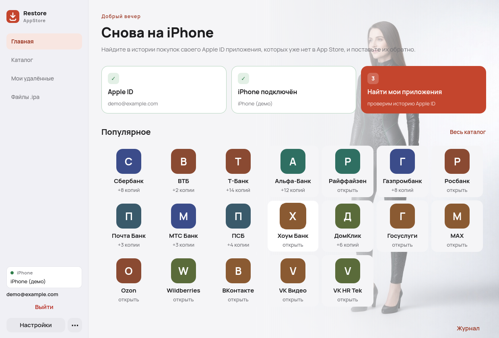
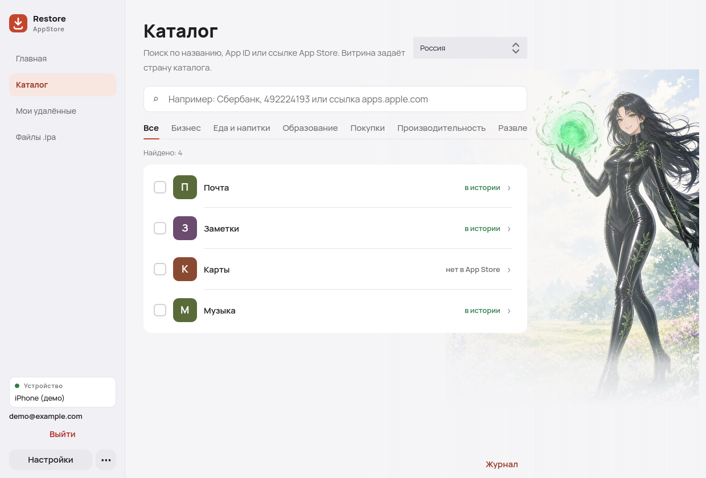
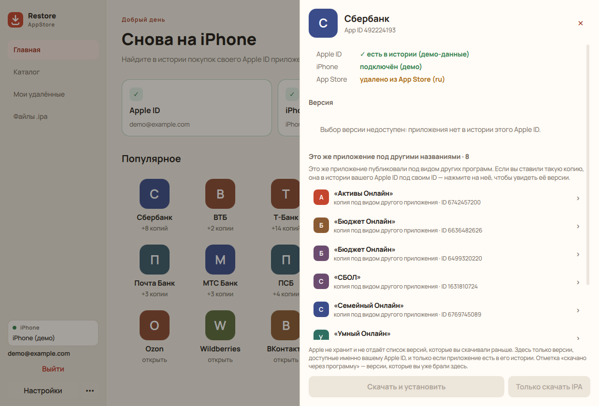
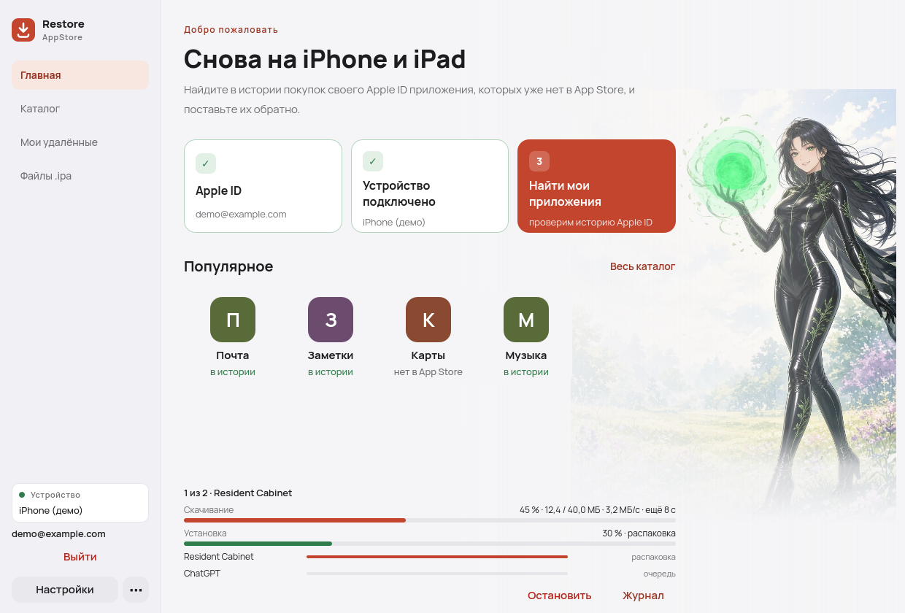
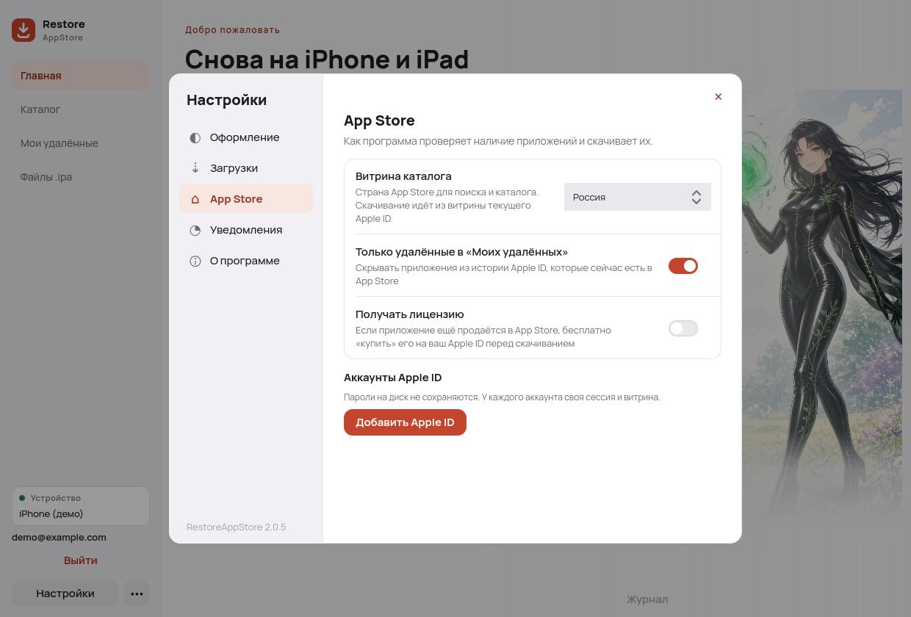
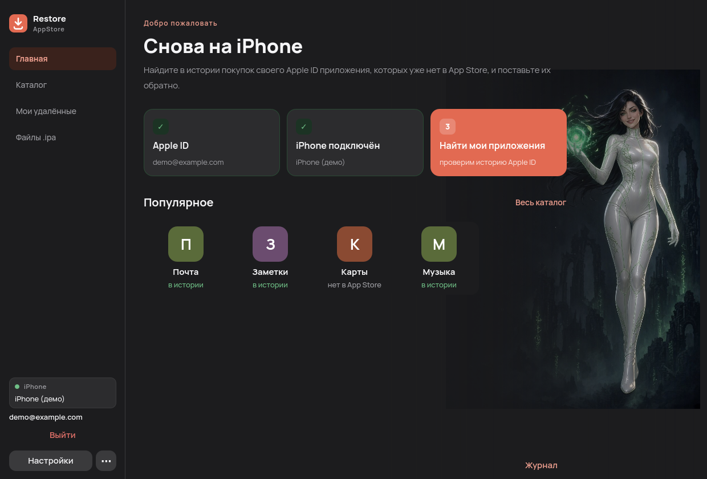
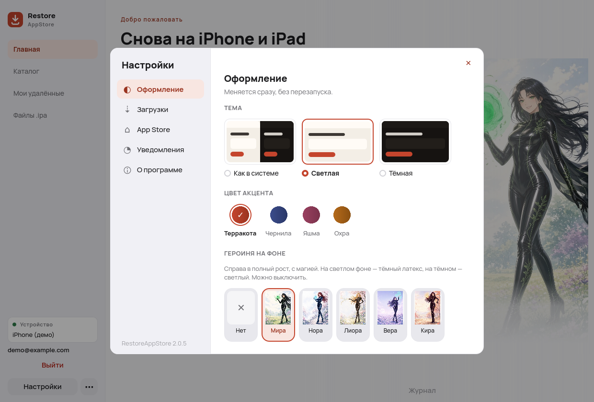
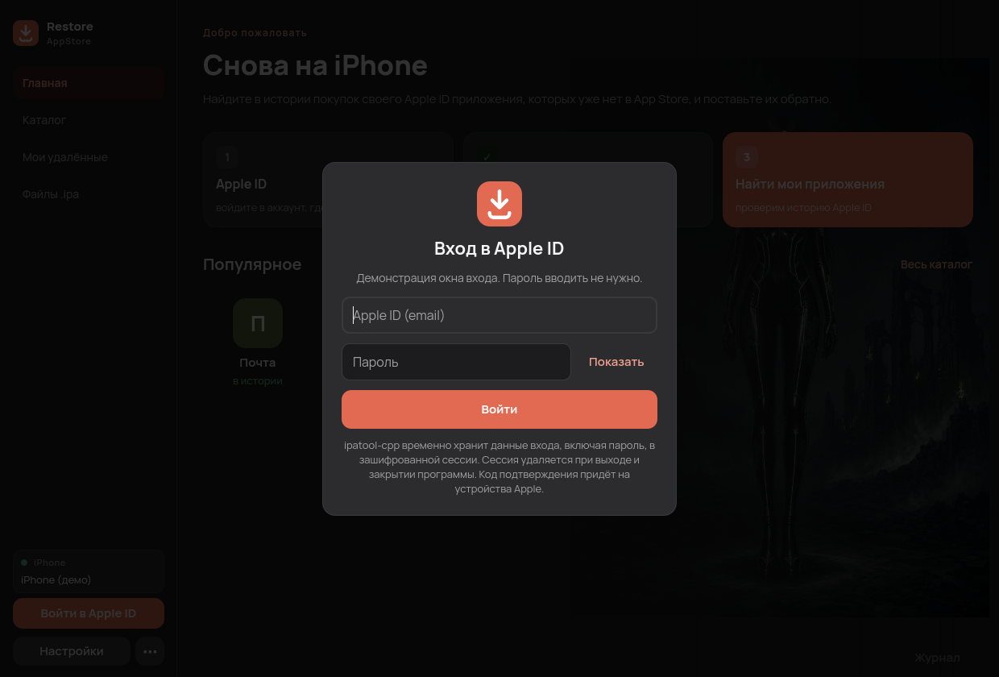
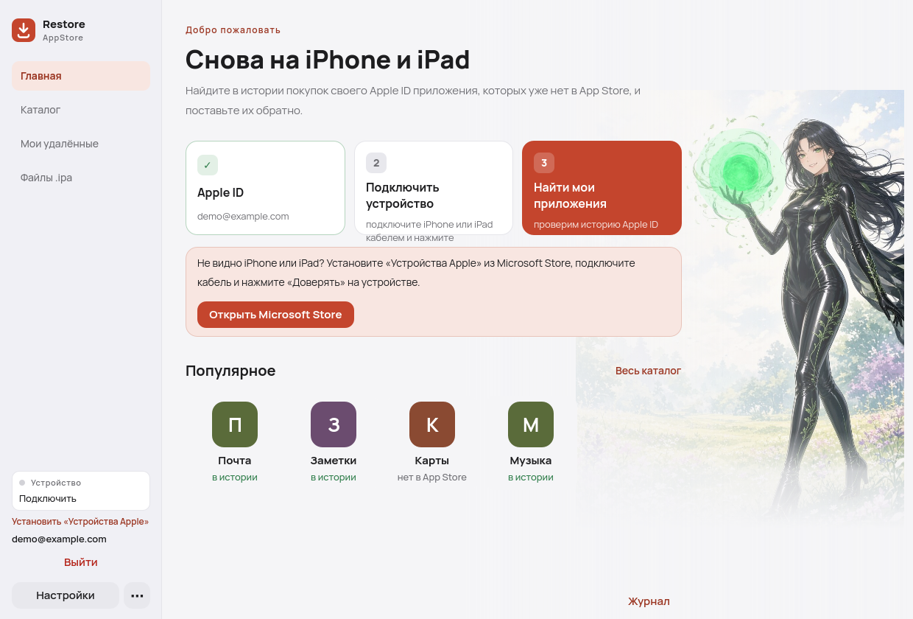

<p align="center">
  <a href="README.md">Русский</a> · <a href="README.en.md">English</a>
</p>

<p align="center">
  
</p>

<h1 align="center">RestoreAppStore for Windows</h1>

<p align="center">
  Re-download apps from your own Apple ID purchase history<br>
  and install the IPA on an iPhone or iPad — if Apple still serves the file.
</p>

<p align="center">
  <a href="https://github.com/freeon1989/RestoreAppStore/releases/latest/download/RestoreAppStore-win-x64.exe"></a>
</p>

<p align="center">
  <a href="https://github.com/freeon1989/RestoreAppStore/releases/latest"></a>
  <a href="LICENSE"></a> <a href="licenses/GPL-3.0.txt"></a>
  <a href="https://github.com/freeon1989/RestoreAppStore/releases/latest"></a>
</p>

RestoreAppStore is a standalone app for 64-bit Windows 10 or 11. No installer is required: download the exe and run it.

> [!IMPORTANT]
> The program downloads apps from Apple's servers **with your Apple ID**, and only titles that **already appear in that account's purchase history**. Apple will not serve an app that was never downloaded on this account, and the program does not try to bypass that.

## Download

**[Download RestoreAppStore for Windows (x64)](https://github.com/freeon1989/RestoreAppStore/releases/latest/download/RestoreAppStore-win-x64.exe)**

[exe, no installer](https://github.com/freeon1989/RestoreAppStore/releases/latest/download/RestoreAppStore-win-x64.exe)
· [latest release page](https://github.com/freeon1989/RestoreAppStore/releases/latest)
· [portable zip](https://github.com/freeon1989/RestoreAppStore/releases/latest/download/RestoreAppStore-win-x64.zip)
· [SHA-256 of the exe](https://github.com/freeon1989/RestoreAppStore/releases/latest/download/RestoreAppStore-win-x64.exe.sha256)
· [SHA-256 of the zip](https://github.com/freeon1989/RestoreAppStore/releases/latest/download/RestoreAppStore-win-x64.zip.sha256)

Current version: **2.0.6**. Requires **64-bit Windows 10 or 11**.

Run `RestoreAppStore-win-x64.exe`, or unpack `RestoreAppStore-win-x64.zip` and open `RestoreAppStore\RestoreAppStore.exe`. The build is not digitally signed, so Windows SmartScreen may show “Windows protected your PC”. Click “More info” → “Run anyway”.

## Screenshots

The screenshots were taken in demo mode (account `demo@example.com`, device “iPhone (demo)”, with the anime-style heroine Mira in the background). This is not a real Apple ID and not a connected phone. The light theme uses a bright fairy-tale backdrop; the dark theme uses dark fantasy.

Home screen (light theme):



<table>
  <tr>
    <td width="58%"></td>
    <td width="42%"></td>
  </tr>
  <tr>
    <td align="center">Catalogue with App Store storefront picker</td>
    <td align="center">App pane: versions and copies (demo data)</td>
  </tr>
  <tr>
    <td width="58%"></td>
    <td width="42%"></td>
  </tr>
  <tr>
    <td align="center">Two progress bars: download and install</td>
    <td align="center">Catalogue storefront and multiple Apple IDs</td>
  </tr>
  <tr>
    <td width="58%"></td>
    <td width="42%"></td>
  </tr>
  <tr>
    <td align="center">Dark theme</td>
    <td align="center">Settings: theme and accent colour</td>
  </tr>
  <tr>
    <td width="58%"></td>
    <td width="42%"></td>
  </tr>
  <tr>
    <td align="center">Apple ID sign-in (demo, no password needed)</td>
    <td align="center">If the iPhone is not detected: link to Apple Devices</td>
  </tr>
</table>

Appearance notes are in [docs/design.md](docs/design.md).

## Features

- Sidebar: Home, Catalogue, My removed apps (titles found in your Apple ID history) and IPA files.
- Home shows short steps (sign in, phone, search history) and popular apps.
- Search by name, App ID or App Store URL, plus categories from the catalogue response.
- Purchase history for your Apple ID, compared with the current catalogue: which history titles are already gone from the App Store.
- Version picker from what ipatool-cpp serves. If a build uses Apple's old code-signature format and current iOS will reject it, the program warns before install and offers a newer version.
- “Download IPA only” or “Download and install” over a cable, including several apps in a queue. Two progress bars are shown: download (percent, size, speed, time left) and install (percent and stage). A finished `.ipa` can be installed later without signing into Apple ID again.
- The catalogue can be browsed in another country's storefront (Russia, the United States, Kazakhstan and others). Apple only serves the file in the Apple ID's own storefront: you can save several accounts and switch between them. Passwords are not written to disk.
- Icons and developer names are also fetched from other storefronts if the app is no longer in the Russian App Store.
- The downloaded IPA is checked (archive and Info.plist) before install: a damaged file is downloaded again instead of being sent to the device. The same version cannot be queued twice.
- On startup the program removes tiny leftover downloads and offers to delete large incomplete ones (for example, a partial Xcode download).
- Mac-only apps (including Xcode) are labelled and are not installed on iPhone or iPad.
- Light and dark themes (or follow the system) and four accent colours.
- A full-height anime-style heroine in the background (Mira, Nora, Liora, Vera, Kira), with a lively pose and magic. She can be changed or turned off in Settings.
- Updates from GitHub Releases with a SHA-256 check and rollback to the previous copy: Settings → About.
- Error messages in Russian and a log at the bottom of the window.

## Requirements

- 64-bit **Windows 10 or 11**.
- An Apple ID that previously downloaded the app you need.
- To **install** on a phone: an unlocked iPhone or iPad, a USB cable, and the Apple Devices app. See “Before you start”.
- To **download the IPA only**, a phone is not required.

## Before you start

For Windows to see an iPhone over a cable, you need Apple's official **Apple Devices** app from Microsoft Store.

1. Install [Apple Devices from Microsoft Store](https://apps.microsoft.com/detail/9NP83LWLPZ9K) (publisher: Apple Inc., product ID `9NP83LWLPZ9K`).
2. Connect the unlocked iPhone with a USB cable.
3. On the phone, tap “Trust This Computer?”.

If the program does not see the iPhone, the same hint and a button that opens Microsoft Store appear on the home screen. The link is also in Settings → About and in the help.

A phone is not required if you only want to download the IPA.

## How to use

1. Download `RestoreAppStore-win-x64.exe` and check its SHA-256 against the sum above or the `.sha256` file from the same release.
2. Run the exe. Click “Sign in to Apple ID” and sign in with the account that previously downloaded the app. If Apple sends a verification code, enter it in the same sign-in window. A push notification often does not arrive: on the iPhone or iPad open Settings → your name → Sign-In & Security → Get Verification Code. The program also installs apps on iPad. If the device is not visible or sign-in fails, open Settings → About → Open logs folder and send `app.log` and `startup.log`. Cable diagnostics without the window: `RestoreAppStore.exe --diag-device` (result in `app.log`).
3. Find the app in Popular on the home screen, in the Catalogue (you can change the storefront country) or via “Find my apps” — matches appear under My removed apps. If the app is not in the current Apple ID's storefront, the program suggests which saved account can download it, or asks you to sign in to an Apple ID for that country.
4. Open the app card and choose “Download and install” or “Download IPA only”. Two progress bars appear at the bottom of the window. If the selected version is too old for your iOS, you will see an explanation and a “Choose a newer version” button.

## Building from source

You need Python 3.12, the dependencies in `requirements-build.txt`, and `ipatool-cpp` 1.3.4 at `build/res/ipatool-cpp.exe` (checksums are in [BUILD-CPP-ONLY.md](BUILD-CPP-ONLY.md)). Engine licences are in `licenses/`; copy them into `build/res/` before the build. Then:

```text
python tools\write_version_info.py build\version_info.txt
python -m PyInstaller --noconfirm --clean RestoreAppStore.spec
```

Output: `dist\RestoreAppStore.exe`. The portable one-file exe can be renamed to `RestoreAppStore-win-x64.exe`.

Run without packaging (Python 3.12 and ipatool-cpp on `PATH` or next to the scripts):

```text
py -V:3.12 -m pip install PySide6 pymobiledevice3 segno
py -V:3.12 restore_apps_gui.py
```

Logic tests, with no network, Apple ID or iPhone:

```text
py -V:3.12 -m unittest discover tests
```

## Licence

RestoreAppStore source code is [MIT](LICENSE), © 2026 freeon1989. The Windows binary is distributed under [GPL-3.0](licenses/GPL-3.0.txt) because of third-party components (Unicorn inside ipatool-cpp, pymobiledevice3). Details are in [THIRD_PARTY_NOTICES.md](THIRD_PARTY_NOTICES.md).

This project is not affiliated with Apple. App Store, iPhone and iOS are trademarks of Apple Inc. Use the program only for apps from your own Apple ID purchase history.
