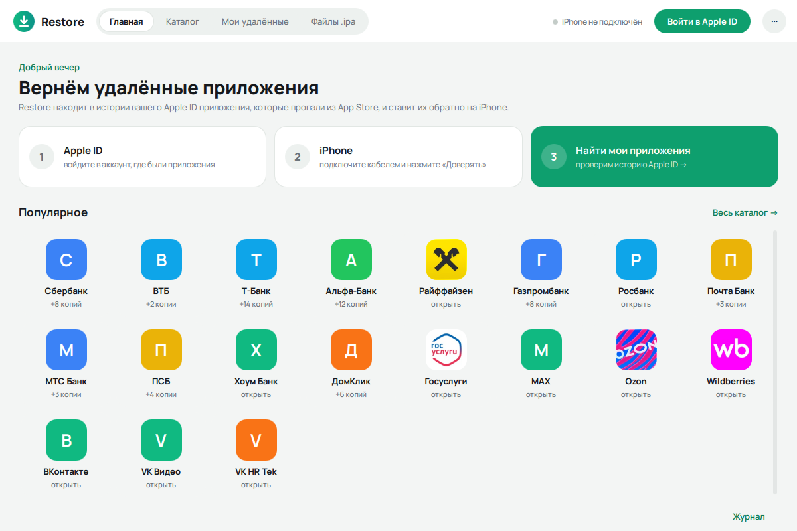
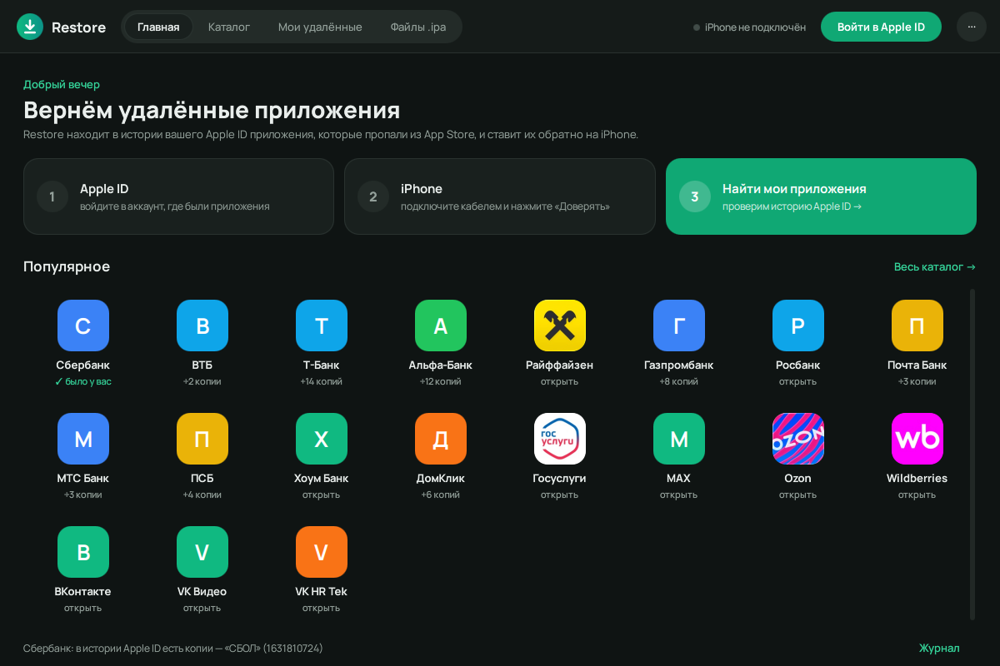

<p align="center">
  
</p>

<h1 align="center">RestoreAppStore для Windows</h1>

<p align="center">
  Скачивание приложений из истории покупок вашего Apple ID<br>
  и установка IPA на iPhone — если Apple по-прежнему отдаёт файл.
</p>

<p align="center">
  <a href="https://github.com/freeon1989/RestoreAppStore/releases/latest/download/RestoreAppStore-cpp-only-1.3.4.exe"></a>
</p>

<p align="center">
  <a href="https://github.com/freeon1989/RestoreAppStore/releases/latest"></a>
  <a href="LICENSE"></a>
  <a href="https://github.com/freeon1989/RestoreAppStore/releases/latest"></a>
</p>

Портативная сборка [RestoreIPA](https://github.com/ToXiTy13/RestoreIPA) v1.2.0 для 64-битной Windows 10 или 11. Компонент подключения к App Store в этой сборке — [ipatool-cpp 1.3.4](https://github.com/Sorvigolova/ipatool/releases/tag/1.3.4). Установка не требуется: достаточно скачать exe и запустить.

*A portable Windows build of RestoreIPA: re-download apps from your own App Store purchase history and, if you want, install the IPA on an iPhone.*

> [!IMPORTANT]
> Программа скачивает приложения с серверов Apple **под вашим Apple ID** и только те, что **уже есть в истории покупок этого аккаунта**. Чужое или никогда не скачанное приложение Apple не отдаст, и программа не пытается это обойти.

## Скачать

**[Скачать RestoreAppStore для Windows (x64)](https://github.com/freeon1989/RestoreAppStore/releases/latest/download/RestoreAppStore-cpp-only-1.3.4.exe)**

[около 90 МБ, exe, без установки](https://github.com/freeon1989/RestoreAppStore/releases/latest/download/RestoreAppStore-cpp-only-1.3.4.exe)
· [страница релиза](https://github.com/freeon1989/RestoreAppStore/releases/tag/v1.2.0-cpp.1.3.4)
· [SHA256SUMS.txt](https://github.com/freeon1989/RestoreAppStore/releases/latest/download/SHA256SUMS.txt)
· [исходники](https://github.com/freeon1989/RestoreAppStore/releases/latest/download/RestoreAppStore-cpp-only-source.zip)

Текущий релиз: **v1.2.0-cpp.1.3.4** (код приложения `1.2.0-local.4`, движок ipatool-cpp 1.3.4). Нужна **64-битная Windows 10 или 11**.

Запустите скачанный `RestoreAppStore-cpp-only-1.3.4.exe`. Сборка не подписана цифровым сертификатом, поэтому Windows SmartScreen может показать предупреждение «Windows защитила ваш компьютер». Нажмите «Подробнее» → «Выполнить в любом случае».

SHA-256 файла `RestoreAppStore-cpp-only-1.3.4.exe`:

```
082d7d755c715e9a615536841e18ff8e95caea301ed962b67c79a460f8f8c8c0
```

В PowerShell проверка такая:

```powershell
Get-FileHash .\RestoreAppStore-cpp-only-1.3.4.exe -Algorithm SHA256
```

SHA-256 архива исходников `RestoreAppStore-cpp-only-source.zip`:

```
6f028297590710b3420795280ff72917d1090faf6076859ea06a95e32a5c0e89
```

## Скриншоты

Главный экран:



<table>
  <tr>
    <td width="58%"></td>
    <td width="42%"></td>
  </tr>
  <tr>
    <td align="center">Каталог и поиск</td>
    <td align="center">Панель приложения: версии и копии (демо-данные)</td>
  </tr>
  <tr>
    <td width="58%"></td>
    <td width="42%"></td>
  </tr>
  <tr>
    <td align="center">Тёмная тема</td>
    <td align="center">Настройки: тема и цвет акцента</td>
  </tr>
</table>

Снимки — из документации проекта и показывают интерфейс программы. В окне настроек на одном из них ещё указана более ранняя подпись версии.

## Возможности

- Четыре вкладки: «Главная» (шаги входа и популярные приложения), «Каталог», «Мои удалённые» (что нашлось в истории вашего Apple ID) и «Файлы .ipa».
- Каталог из 700+ приложений, удалённых из российского App Store, с поиском по названию, App ID или ссылке App Store и делением на категории.
- Проверка истории вашего Apple ID: программа показывает, какие из этих приложений у вас были.
- Копии под другими названиями (например, банк, опубликованный как другое приложение). В панели видны все копии, и можно проверить, какие есть у вас.
- Выбор версии или режим «Автоматически» — новейшая версия, подходящая для iOS вашего iPhone.
- «Только скачать IPA» или «Скачать и установить» по кабелю, в том числе несколько приложений по очереди. Готовый `.ipa` можно поставить и без повторного входа в Apple ID.
- Светлая и тёмная тема (или как в системе) и четыре цвета акцента.
- Понятные сообщения об ошибках по-русски и журнал внизу окна.

В этой сборке при запуске выбран движок **ipatool-cpp**. Автопроверка обновлений исходного проекта и кнопки «Поддержать разработчика» в интерфейсе отключены.

## Что нужно

- 64-битная **Windows 10 или 11**.
- Apple ID, под которым нужное приложение когда-то скачивалось.
- Чтобы **поставить** приложение на телефон: разблокированный iPhone, кабель USB и «Устройства Apple» либо iTunes. На запрос «Доверять этому компьютеру?» нажмите «Доверять».
- Чтобы **только скачать IPA**, телефон не обязателен.

## Как пользоваться

1. Скачайте `RestoreAppStore-cpp-only-1.3.4.exe` и сверьте SHA-256 с суммой выше или с `SHA256SUMS.txt` из того же релиза.
2. Запустите exe. Нажмите «Войти в Apple ID» и войдите в аккаунт, с которого раньше скачивали нужное приложение. Если Apple запросит код подтверждения, введите его в окне программы. Первый вход может занять несколько минут.
3. Найдите приложение в «Популярном» на главной, в «Каталоге» или через «Найти мои приложения» — найденное появится во вкладке «Мои удалённые».
4. Откройте приложение и выберите «Только скачать IPA» либо «Скачать и установить». Для установки подключите разблокированный iPhone по USB и подтвердите доверие компьютеру.

Скачанные `.ipa` в портативной сборке сохраняются в папку `ipa` рядом с exe, если не выбрать другую папку в «⋯» → «Настройки» → «Загрузки».

## Частые проблемы

| Что видите | Что делать |
|---|---|
| Нет связи с Apple, `no such host`, `i/o timeout` | Проверьте DNS и файл `hosts`: сервисы «для обхода блокировок» иногда подменяют адреса Apple. В меню «⋯» есть пункт «Проверить связь с Apple». |
| Ошибка сертификата, `x509` | Антивирус проверяет HTTPS. Отключите проверку защищённых соединений или добавьте программу в исключения. |
| «Не было у этого Apple ID» | Приложения нет в истории этого аккаунта. Посмотрите копии под другими названиями или войдите под тем Apple ID, которым скачивали. |
| `HTTP 429`, ограничение попыток | Не повторяйте вход сразу — подождите около часа. |
| iPhone не найден | Нужны кабель, разблокированный телефон, «Доверять» и на Windows — «Устройства Apple» либо iTunes. |
| SmartScreen блокирует запуск | Сборка не подписана: «Подробнее» → «Выполнить в любом случае», предварительно сверив SHA-256. |

Подробности ошибки — в «Журнале» справа внизу. Если пишете об ошибке, приложите текст оттуда, но уберите адрес Apple ID, пароль и код подтверждения.

## Безопасность и данные

- Пароль Apple ID программа на диск не сохраняет: он нужен только для входа. ipatool-cpp может временно держать сессию в зашифрованном файле; эта сборка задаёт случайный пароль шифрования на каждый запуск и удаляет сессию при выходе, закрытии и следующем запуске.
- Пароль, код 2FA и пароль сессии маскируются в журнале. Пока идёт вход, пароль всё же передаётся дочернему процессу аргументом командной строки и в этот момент может быть виден другим программам под вашей учётной записью Windows.
- **Скачанные `.ipa` содержат ваш Apple ID и имя** (`iTunesMetadata.plist`) и привязаны к вашему аккаунту. Не выкладывайте их в открытый доступ.
- Служебные файлы программы — в `%LOCALAPPDATA%\Restore`.

## Что проверено

Встроенная проверка интерфейса (`--check-ui`) для этой сборки прошла. Вход в Apple ID, скачивание IPA и установка на iPhone с реальным аккаунтом **не проверялись**.

## Сборка из исходников

Исходники этой сборки лежат в репозитории и дублируются в архиве [RestoreAppStore-cpp-only-source.zip](https://github.com/freeon1989/RestoreAppStore/releases/latest/download/RestoreAppStore-cpp-only-source.zip) релиза. Как собирался опубликованный exe — в [BUILD-CPP-ONLY.md](BUILD-CPP-ONLY.md). Кратко, на Windows с Python 3.12:

1. Возьмите портативный `RestoreAppStore.exe` из [RestoreIPA v1.2.0](https://github.com/ToXiTy13/RestoreIPA/releases/tag/v1.2.0).
2. Скачайте архив Windows x64 [ipatool-cpp 1.3.4](https://github.com/Sorvigolova/ipatool/releases/tag/1.3.4) (SHA-256 ZIP: `f825512372346f2a29bd3be6ee9a2234a4de9781cdfbb597299d6a06ff36eb43`) и положите exe в `build/res/ipatool-cpp.exe` (SHA-256 EXE: `3ab8167cbe3a36f3e12bf20ba4e7b9bd06a7b3165566973de3758786894edb0f`).
3. Из корня репозитория:

```text
python rebuild_portable.py PATH_TO_ORIGINAL_EXE . RestoreAppStore-cpp-only-1.3.4.exe
```

Контрольная сумма результата может отличаться от опубликованного файла из-за параметров упаковки PyInstaller.

Запуск без упаковки (нужен Python 3.12 и ipatool-cpp в `PATH` или рядом со скриптами):

```text
py -V:3.12 -m pip install PySide6 pymobiledevice3 segno
py -V:3.12 restore_apps_gui.py
```

Тесты логики, без сети, Apple ID и iPhone:

```text
py -V:3.12 -m unittest discover tests
```

Полная сборка исходного проекта RestoreIPA через `build.ps1` рассчитана на другой набор движков (официальный ipatool), не на эту cpp-only поставку. Подробности локальных отличий — в [LOCAL_CHANGES.txt](LOCAL_CHANGES.txt).

## Лицензия и авторы

[GPL-3.0](LICENSE). Это производная сборка [RestoreIPA](https://github.com/ToXiTy13/RestoreIPA) (ToXiTy13). Движок [ipatool-cpp](https://github.com/Sorvigolova/ipatool) распространяется по MIT; готовый Windows-бинарник движка в опубликованном exe взят из указанного в `LOCAL_CHANGES.txt` источника, лицензии — в каталоге [licenses](licenses) и в [THIRD_PARTY_NOTICES.md](THIRD_PARTY_NOTICES.md).

Поддержать исходного автора RestoreIPA можно на странице его репозитория.

Проект не связан с Apple. App Store, iPhone и iOS — товарные знаки Apple Inc. Используйте программу только для приложений из истории покупок своего Apple ID.
