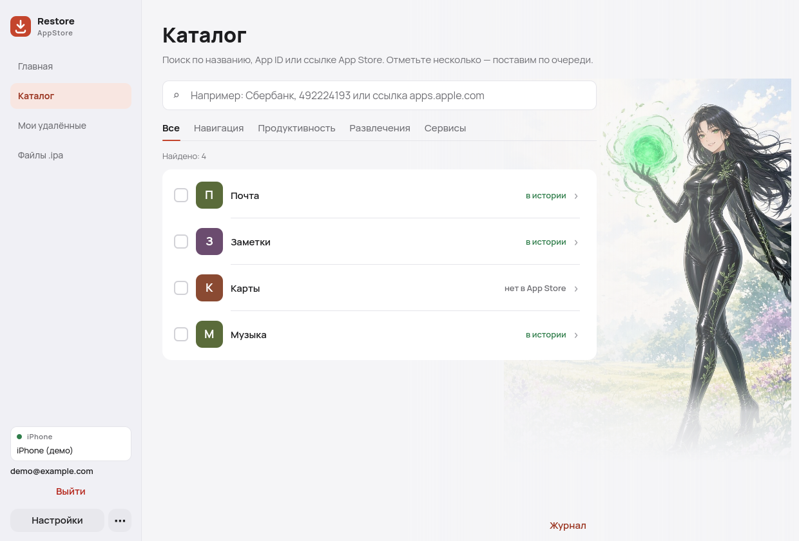
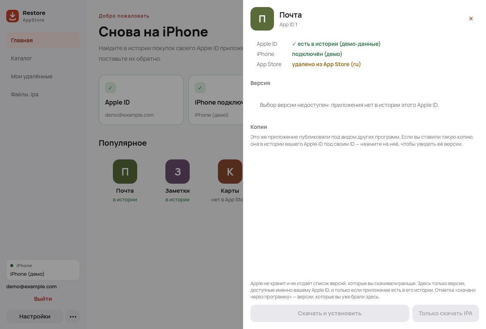
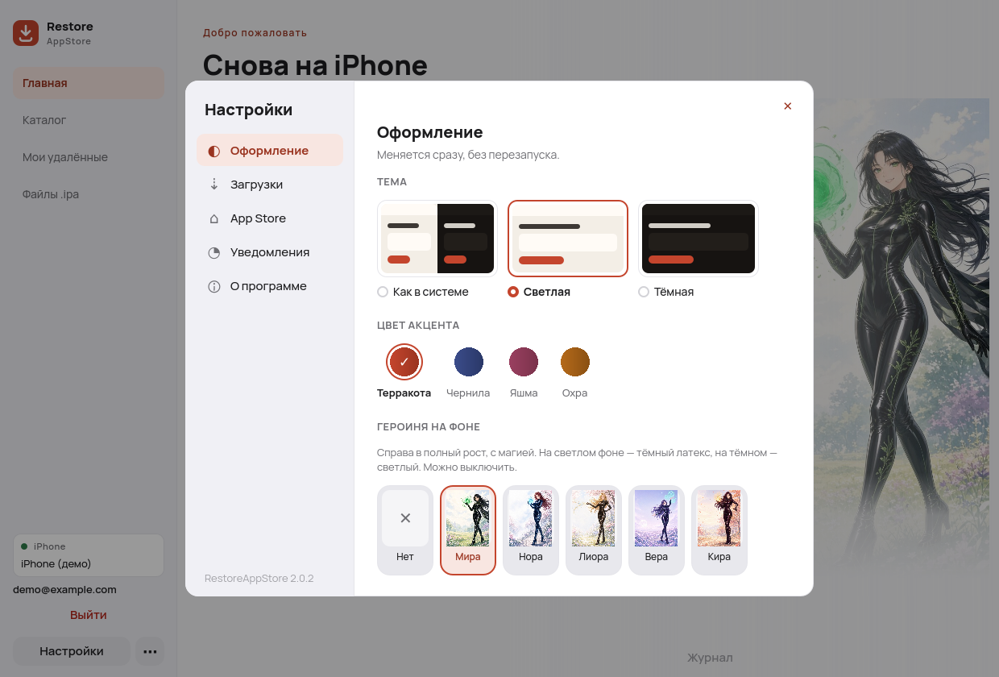
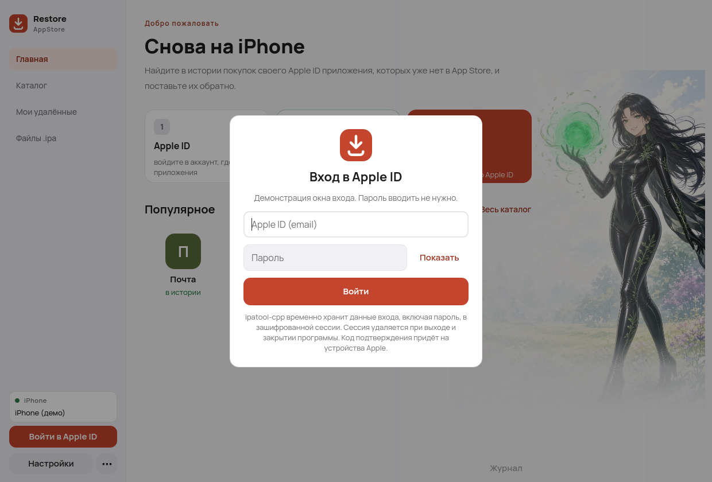
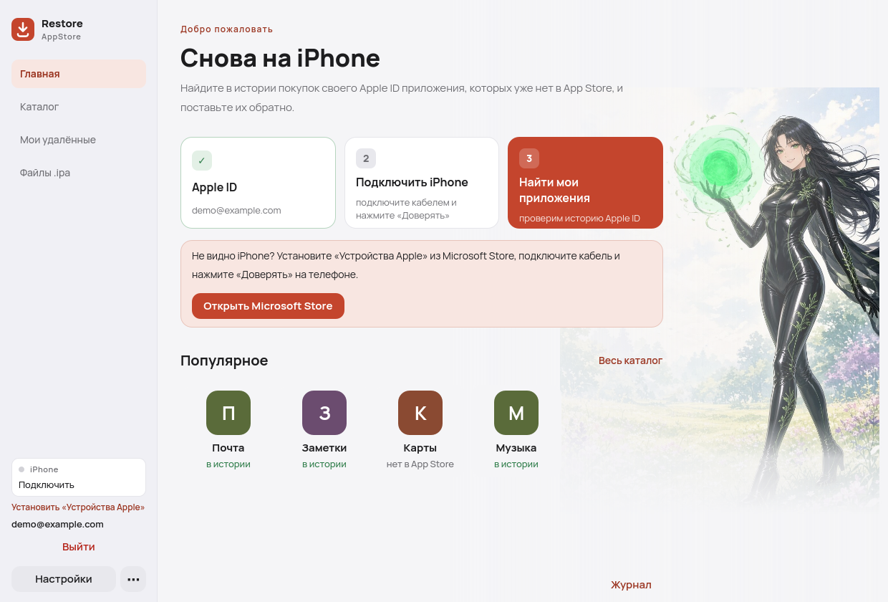

<p align="center">
  
</p>

<h1 align="center">RestoreAppStore для Windows</h1>

<p align="center">
  Скачивание приложений из истории покупок вашего Apple ID<br>
  и установка IPA на iPhone — если Apple по-прежнему отдаёт файл.
</p>

<p align="center">
  <a href="https://github.com/freeon1989/RestoreAppStore/releases/latest/download/RestoreAppStore-win-x64.exe"></a>
</p>

<p align="center">
  <a href="https://github.com/freeon1989/RestoreAppStore/releases/latest"></a>
  <a href="LICENSE"></a> <a href="licenses/GPL-3.0.txt"></a>
  <a href="https://github.com/freeon1989/RestoreAppStore/releases/latest"></a>
</p>

RestoreAppStore — самостоятельная программа для 64-битной Windows 10 или 11. Установка не требуется: достаточно скачать exe и запустить.

*A Windows 10/11 x64 app to re-download titles from your own App Store purchase history and, if you want, install the IPA on an iPhone.*

> [!IMPORTANT]
> Программа скачивает приложения с серверов Apple **под вашим Apple ID** и только те, что **уже есть в истории покупок этого аккаунта**. Чужое или никогда не скачанное приложение Apple не отдаст, и программа не пытается это обойти.

## Скачать

**[Скачать RestoreAppStore для Windows (x64)](https://github.com/freeon1989/RestoreAppStore/releases/latest/download/RestoreAppStore-win-x64.exe)**

[exe, без установки](https://github.com/freeon1989/RestoreAppStore/releases/latest/download/RestoreAppStore-win-x64.exe)
· [страница последнего релиза](https://github.com/freeon1989/RestoreAppStore/releases/latest)
· [папка без распаковки в память: zip](https://github.com/freeon1989/RestoreAppStore/releases/latest/download/RestoreAppStore-win-x64.zip)
· [SHA-256 exe](https://github.com/freeon1989/RestoreAppStore/releases/latest/download/RestoreAppStore-win-x64.exe.sha256)
· [SHA-256 zip](https://github.com/freeon1989/RestoreAppStore/releases/latest/download/RestoreAppStore-win-x64.zip.sha256)

Актуальная версия: **2.0.2**. Нужна **64-битная Windows 10 или 11**.

Запустите скачанный `RestoreAppStore-win-x64.exe` либо распакуйте `RestoreAppStore-win-x64.zip` и откройте `RestoreAppStore\RestoreAppStore.exe`. Сборка не подписана цифровым сертификатом, поэтому Windows SmartScreen может показать предупреждение «Windows защитила ваш компьютер». Нажмите «Подробнее» → «Выполнить в любом случае».

Если окно не откроется, пришлите файл `%LOCALAPPDATA%\RestoreAppStore\startup.log` (это журнал запуска, не настройки и не пароль).

Если уже стоит предыдущая версия, в программе откройте «Настройки → О программе → Проверить обновления».

SHA-256 файла `RestoreAppStore-win-x64.exe` (версия 2.0.2):

```
85fa3b376d18b5d8f1bd807784e0eb01a752b55c2f57b4124570d89b2234030f
```

В PowerShell проверка такая:

```powershell
Get-FileHash .\RestoreAppStore-win-x64.exe -Algorithm SHA256
```

SHA-256 архива `RestoreAppStore-win-x64.zip` (версия 2.0.2):

```
97c0c2b38c2afa017ed8d8ad1f44865f074e3591100b1a6e27913ace52d547a3
```


## Скриншоты

Снимки сняты в демонстрационном режиме (учётная запись `demo@example.com`, устройство «iPhone (демо)», на фоне героиня Мира в аниме-стиле). Это не настоящий Apple ID и не подключённый телефон. В светлой теме фон — светлая сказка, в тёмной — dark fantasy.

Главный экран (светлая тема):


<table>
  <tr>
    <td width="58%"></td>
    <td width="42%"></td>
  </tr>
  <tr>
    <td align="center">Каталог и поиск</td>
    <td align="center">Панель приложения: версии и копии (демо-данные)</td>
  </tr>
  <tr>
    <td width="58%"></td>
    <td width="42%"></td>
  </tr>
  <tr>
    <td align="center">Тёмная тема</td>
    <td align="center">Настройки: тема и цвет акцента</td>
  </tr>
  <tr>
    <td width="58%"></td>
    <td width="42%"></td>
  </tr>
  <tr>
    <td align="center">Вход в Apple ID (демо, пароль вводить не нужно)</td>
    <td align="center">Если iPhone не виден: ссылка на «Устройства Apple»</td>
  </tr>
</table>

Оформление описано в [docs/design.md](docs/design.md).

## Возможности

- Боковая панель: «Главная», «Каталог», «Мои удалённые» (что нашлось в истории вашего Apple ID) и «Файлы .ipa».
- На главной — короткие шаги (вход, телефон, поиск в истории) и популярные приложения.
- Поиск по названию, App ID или ссылке App Store и категории из ответа каталога.
- История покупок вашего Apple ID и сверка с текущим каталогом: какие приложения из истории уже пропали из App Store.
- Выбор версии, которую отдаёт ipatool-cpp. Старые сборки Apple может больше не подписывать.
- «Только скачать IPA» или «Скачать и установить» по кабелю, в том числе несколько приложений по очереди. Готовый `.ipa` можно поставить и без повторного входа в Apple ID.
- Светлая и тёмная тема (или как в системе) и четыре цвета акцента: терракота, чернила, яшма, охра.
- Героиня на фоне в полный рост, в аниме-стиле, с живой позой и магией (Мира, Нора, Лиора, Вера, Кира): в светлой теме — светлая сказка и тёмный латекс, в тёмной — dark fantasy и светлый латекс. В настройках можно сменить или выключить.
- Обновление из GitHub Releases с проверкой SHA-256 и откатом на предыдущую копию: «Настройки → О программе».
- Понятные сообщения об ошибках по-русски и журнал внизу окна.

## Что нужно

- 64-битная **Windows 10 или 11**.
- Apple ID, под которым нужное приложение когда-то скачивалось.
- Чтобы **поставить** приложение на телефон: разблокированный iPhone, кабель USB и приложение «Устройства Apple». Подробности — в разделе «Перед началом».
- Чтобы **только скачать IPA**, телефон не обязателен.

## Перед началом

Чтобы Windows увидела iPhone по кабелю, нужно официальное приложение Apple «Устройства Apple» (Apple Devices) из Microsoft Store.

1. Установите [«Устройства Apple» из Microsoft Store](https://apps.microsoft.com/detail/9NP83LWLPZ9K) (издатель — Apple Inc., код продукта `9NP83LWLPZ9K`).
2. Подключите разблокированный iPhone кабелем USB.
3. На телефоне нажмите «Доверять этому компьютеру?».

Если программа не видит iPhone, на главном экране появится та же подсказка и кнопка, которая открывает Microsoft Store. Ссылку можно открыть и в «Настройки → О программе» или в справке.

Чтобы только скачать IPA, телефон не обязателен.

## Как пользоваться

1. Скачайте `RestoreAppStore-win-x64.exe` и сверьте SHA-256 с суммой выше или с файлом `.sha256` из того же релиза.
2. Запустите exe. Нажмите «Войти в Apple ID» и войдите в аккаунт, с которого раньше скачивали нужное приложение. Если Apple запросит код подтверждения, введите его в окне программы. Первый вход может занять несколько минут.
3. Найдите приложение в «Популярном» на главной, в «Каталоге» или через «Найти мои приложения» — найденное появится в разделе «Мои удалённые».
4. Откройте карточку приложения и выберите «Скачать и установить» или «Только скачать IPA».

## Сборка из исходников

Нужны Python 3.12, зависимости из `requirements-build.txt` и `ipatool-cpp` 1.3.4 в `build/res/ipatool-cpp.exe` (см. контрольные суммы в [BUILD-CPP-ONLY.md](BUILD-CPP-ONLY.md)). Лицензии движка — в `licenses/`, перед сборкой их нужно скопировать в `build/res/`. Затем:

```text
python tools\write_version_info.py build\version_info.txt
python -m PyInstaller --noconfirm --clean RestoreAppStore.spec
```

Готовый файл: `dist\RestoreAppStore.exe`. Портативный однофайловый exe можно переименовать в `RestoreAppStore-win-x64.exe`.

Запуск без упаковки (нужен Python 3.12 и ipatool-cpp в `PATH` или рядом со скриптами):

```text
py -V:3.12 -m pip install PySide6 pymobiledevice3 segno
py -V:3.12 restore_apps_gui.py
```

Тесты логики, без сети, Apple ID и iPhone:

```text
py -V:3.12 -m unittest discover tests
```

## Лицензия

Исходный код RestoreAppStore — [MIT](LICENSE), © 2026 freeon1989. Готовая сборка для Windows из‑за сторонних компонентов (Unicorn внутри ipatool-cpp, pymobiledevice3) распространяется под [GPL-3.0](licenses/GPL-3.0.txt). Подробности — в [THIRD_PARTY_NOTICES.md](THIRD_PARTY_NOTICES.md).

Проект не связан с Apple. App Store, iPhone и iOS — товарные знаки Apple Inc. Используйте программу только для приложений из истории покупок своего Apple ID.
